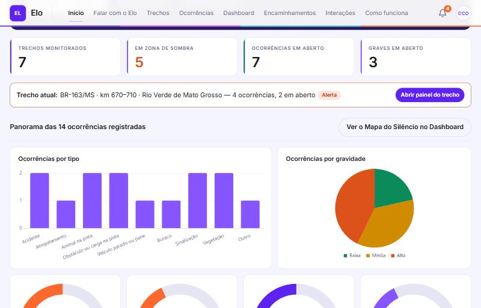
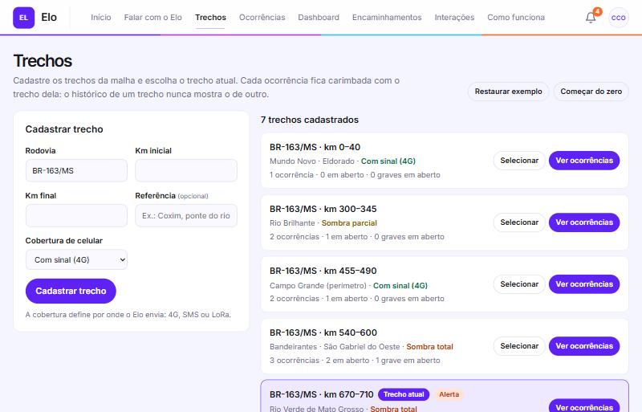
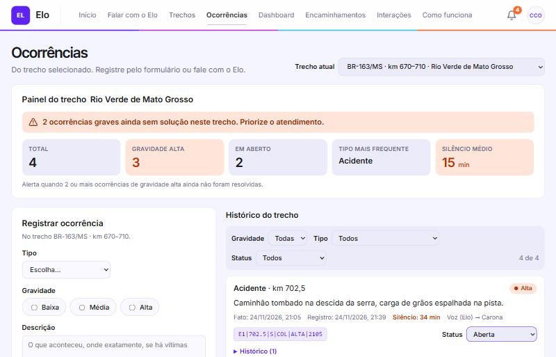
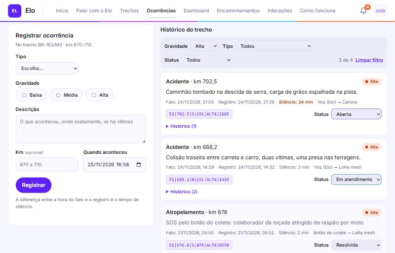
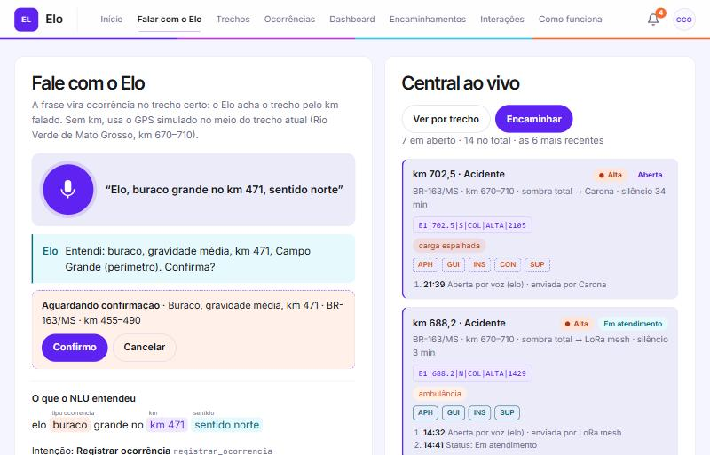
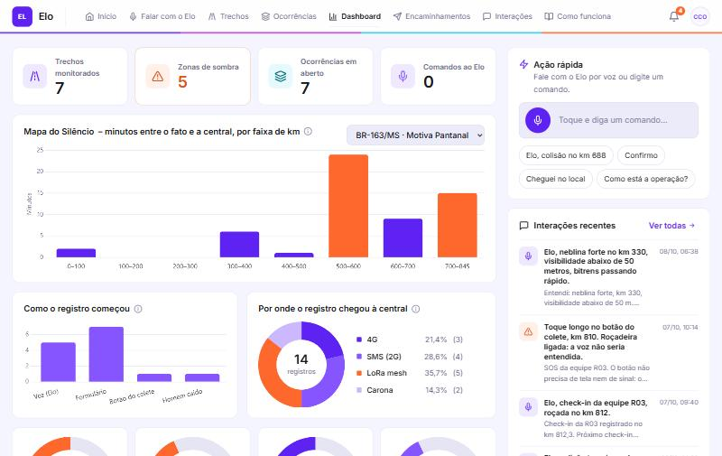
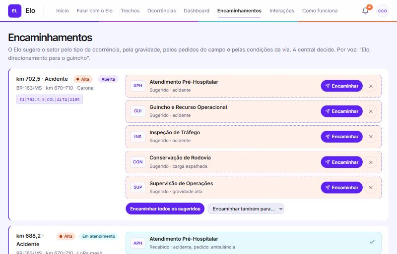

# Elo: o agente de voz para que nenhuma ocorrência fique em silêncio

Desafio Motiva · **Sprint 2** · FIAP 2TIAPR · 2026

O Elo é a plataforma do colaborador de campo da Motiva Pantanal (BR-163/MS). Nesta sprint ele deixou de ser um MVP de consulta e virou uma ferramenta de uso real. O colaborador:

- cadastra trechos;
- registra ocorrências pelo formulário **ou falando com o Elo**;
- acompanha cada trecho num painel calculado;
- filtra e atualiza o status das ocorrências.

Tudo fica salvo no navegador (`localStorage`), e F5 não apaga nada.

## O problema

Na BR-163/MS há longos trechos sem 4G. Quando um inspetor, um socorrista ou uma equipe de conservação presencia um acidente, ou se acidenta, a central só fica sabendo quando alguém acha sinal. O prazo de atendimento da ANTT (15 min) conta **do acionamento**, não do fato.

Chamamos de **tempo de silêncio** os minutos entre o fato acontecer e a central saber. O Elo mede esse tempo em cada ocorrência (`horaFato` × `registradoEm`) e mostra onde ele acontece.

**Por que importa para a Motiva:**
- Em 2025 foram 9 óbitos de trabalho, 8 deles em rodovias, com o atropelamento como principal perigo (Relatório de Sustentabilidade 2025).
- **Segurança** é o primeiro princípio da empresa.

**Quem usa:** o colaborador de campo da Motiva Pantanal (inspeção de tráfego, APH e conservação) e a central (CCO).

## O que a plataforma faz (Sprint 2)

| Requisito do enunciado | Como foi feito |
|---|---|
| 1. Estado na plataforma | O `App.jsx` concentra `trechos`, `trechoAtualId` e `ocorrencias` (mais o estado do agente de voz). Nenhum array fixo alimenta as telas. |
| 2. Cadastro de trechos | `FormTrecho` controlado: rodovia, km inicial, km final, referência e cobertura de celular. O `id` é único, gerado no App. Trechos da mesma rodovia não podem se sobrepor. O trecho atual é escolhido em Trechos, em Ocorrências ou clicando na tabela do Início. |
| 3. Registro de ocorrências | `FormOcorrencia`: tipo, gravidade, descrição, km (opcional) e hora do fato. O App carimba `trechoId`, data/hora do registro e status `aberta`. **Isolamento:** a tela filtra por `trechoId` antes de listar. |
| 4. Consulta e filtro | `ListaOcorrencias` mostra só o trecho selecionado, com `FiltroOcorrencias` por gravidade, tipo e status. O `Selo` colore a gravidade. Há mensagem de vazio para trecho sem ocorrência e para filtro sem resultado. |
| 5. Painel do trecho | `PainelTrecho` desenha o que `src/utils/analisarTrecho.js` calcula: total, gravidade alta, em aberto, tipo mais frequente, silêncio médio e **alerta**. |
| 6. Atualização de status | Cada ocorrência tem `aberta`, `em_atendimento` ou `resolvida`, trocado no próprio card ou por voz ("cheguei no local", "via liberada"). Toda mudança entra no histórico. |
| 7. Persistência | **Um** objeto no `localStorage` (chave `elo:motiva:v2`). É lido na criação do estado e gravado a cada mudança. |
| 8. Componentização | `FormTrecho`, `ListaTrechos`, `FormOcorrencia`, `ListaOcorrencias`, `PainelTrecho` e `Selo`, além de `CardOcorrencia` e `FiltroOcorrencias`. Os props estão descritos abaixo, e toda lista usa `key={item.id}`. |

**Além do pedido:**
- **Agente de voz real:** o colaborador fala e a ocorrência cai no trecho certo pelo km falado.
- **Encaminhamento a setores**, com o Elo sugerindo quem atende.
- **Dashboard calculado** a partir das ocorrências.
- **Botões de dados de exemplo**, para testar rápido.

## Telas

| Tela | O que faz |
|---|---|
| **Início** | Problema, indicadores calculados, faixa do trecho atual (com alerta), gráficos por tipo e gravidade, velocímetros e leitura rápida de todos os trechos |
| **Falar com o Elo** | Microfone (ou texto) → NLU → o Elo lê de volta e pede "Confirma?" → a ocorrência é gravada no trecho do km falado. Mostra o que o NLU entendeu e a central ao vivo |
| **Trechos** | Cadastro, lista com números de cada trecho, seleção do trecho atual, **Restaurar exemplo** e **Começar do zero** |
| **Ocorrências** | Trecho atual: painel, formulário, filtro e histórico com status editável |
| **Dashboard** | KPIs, Mapa do Silêncio, como o registro começou, rota de chegada, velocímetros, ação rápida por voz e interações recentes |
| **Encaminhamentos** | Setores sugeridos para cada ocorrência em aberto; a central encaminha e o setor confirma |
| **Interações** | Últimas 20 falas ao Elo (salvas) e o histórico simulado da Sprint 1 |
| **Como funciona** | A solução completa: comandos de voz, plano B, Código Elo, cascata de envio e princípios da Motiva |

### Prints

| | |
|---|---|
|  Início: indicadores e painel calculados |  Trechos: cadastro e seleção |
|  Ocorrências: painel do trecho com alerta |  Filtro por gravidade, Selo e status |
|  Voz: o Elo pede confirmação |  Dashboard calculado |
|  Encaminhamentos a setores | |

## Vocabulário (o mesmo no formulário, no filtro, no Selo e no NLU)

Definido em `src/data/dominio.js`.

| Campo | Valores |
|---|---|
| `tipo` | `acidente`, `atropelamento`, `animal_na_pista`, `obstaculo`, `veiculo_parado`, `buraco`, `sinalizacao`, `vegetacao`, `outro` |
| `gravidade` | `baixa` (verde), `media` (âmbar), `alta` (laranja-escuro) |
| `status` | `aberta` → `em_atendimento` → `resolvida` (e pode reabrir) |
| `cobertura` (trecho) | `sinal`, `sombra parcial`, `sombra total` |
| `canal` | `voz`, `formulario`, `botao`, `automatico` (os dois últimos são o plano B, presentes nos exemplos) |
| `rota` | `4G`, `SMS (2G)`, `LoRa mesh`, `Carona` (prevista pela cobertura do trecho) |

**Por que tipos "mistos".** O enunciado sugere vegetação, buraco, sinalização e outro. Mantivemos esses e acrescentamos os tipos de **segurança viária** que o Elo já entende por voz (acidente, atropelamento, animal na pista...). Na BR-163, quem mais precisa de um registro rápido é quem presencia um acidente. A voz em detalhe (por exemplo, "vítima presa") é traduzida para esses tipos por `TIPO_DO_GLOSSARIO`.

## Como o estado e o `localStorage` estão organizados

O `App.jsx` é o **único dono** do estado:

```js
const [inicial] = useState(lerEstado)               // lê o localStorage UMA vez
const [trechos, setTrechos] = useState(inicial.trechos)
const [trechoAtualId, setTrechoAtualId] = useState(inicial.trechoAtualId)
const [ocorrencias, setOcorrencias] = useState(inicial.ocorrencias)
const [elo, setElo] = useState({ ...inicial.elo, pendente: null })

useEffect(() => {                                    // grava a cada mudança
  salvarEstado({ trechos, trechoAtualId, ocorrencias, elo: { comandos: elo.comandos, log: elo.log } })
}, [trechos, trechoAtualId, ocorrencias, elo])
```

A leitura acontece **na criação do estado**, não num `useEffect`. Assim o vazio nunca é gravado por cima do que estava salvo (o erro visto na aula de 26/08). As telas só recebem props e avisam o App por funções como `onCadastrar`, `onSelecionar`, `onRegistrar`, `onStatus` e `onAgente`.

**O objeto salvo** (chave `elo:motiva:v2`, em `src/utils/persistencia.js`):

```js
{
  versao: 2,
  trechos: [{ id, rodovia, referencia, kmInicial, kmFinal, cobertura }],
  trechoAtualId: 't-br163-670',
  ocorrencias: [{
    id, trechoId,                       // carimbo do trecho (isolamento)
    tipo, descricao, gravidade, status, // o que o enunciado pede
    horaFato, registradoEm,             // a diferença é o tempo de silêncio
    atendimentoEm, resolvidaEm,         // carimbados quando o status muda
    km, sentido, canal, rota, codigo,   // contexto do Elo
    recursos, condicoes, encaminhamentos, historico,
  }],
  elo: { comandos, log },               // últimas 20 falas ao agente
}
```

**Regras da persistência:**

| Situação | O que acontece |
|---|---|
| Primeira visita, nada salvo | A plataforma abre com os 7 trechos da BR-163 e 14 ocorrências de exemplo, para o professor ver tudo funcionando. |
| Objeto salvo inválido ou de outra versão | Volta para o exemplo. |
| Página atual, filtro e rascunho do Elo aguardando "confirmo" | **Não** são salvos, porque são estado de tela: o F5 volta para o Início. Dados nunca se perdem. |
| **Restaurar exemplo** / **Começar do zero** (tela Trechos) | Trocam todo o estado, com confirmação. |

## Isolamento por trecho

Cada ocorrência nasce com `trechoId`:
- **No formulário**, é o trecho atual.
- **Na voz**, é o trecho que contém o km falado (`trechoDoKm`). Sem km falado, vale o trecho atual (o GPS simulado é o meio do trecho). Se o km não pertence a nenhum trecho, o Elo recusa e pede para cadastrar.

A tela Ocorrências faz `ocorrencias.filter((o) => o.trechoId === trecho.id)` **antes** do filtro e do `map`. Um trecho recém-cadastrado abre vazio, mesmo com 14 ocorrências em outros trechos.

## Painel do trecho (`src/utils/analisarTrecho.js`)

Nos moldes do `analisarPerfil` do CardioIA: recebe só as ocorrências de um trecho e devolve um objeto. Não desenha nada.

| Campo | Significado |
|---|---|
| `total` | quantas ocorrências |
| `graves` | quantas com gravidade alta |
| `gravesAbertas` / `abertas` | quantas ainda não foram resolvidas |
| `tipoFrequente` | o tipo que mais aparece (empate: ordem da lista de tipos) ou "Sem ocorrências" |
| `silencioMedio` | média de minutos entre o fato e o registro |
| `alerta` / `mensagemAlerta` | verdadeiro quando há **2 ou mais ocorrências de gravidade alta ainda não resolvidas** (`LIMITE_ALERTA`) |

A regra do alerta olha as graves **em aberto**: um trecho com três acidentes já resolvidos não precisa de alarme, e um com dois ainda abertos precisa.

## Componentes e props

| Componente | Props | Papel |
|---|---|---|
| `FormTrecho` | `trechos`, `onCadastrar(dados)` | Formulário controlado; valida com `validarTrecho` (`utils/validacao.js`) |
| `ListaTrechos` | `trechos`, `ocorrencias`, `trechoAtualId`, `onSelecionar(id)`, `onAbrir(id)`, `onRemover(id)` | Uma linha por trecho com números de `analisarTrecho`; só remove trecho sem ocorrências |
| `FormOcorrencia` | `trecho`, `onRegistrar(dados)` | Formulário controlado; sugere a gravidade padrão do tipo; valida km dentro do trecho e hora não futura |
| `ListaOcorrencias` | `ocorrencias` (já do trecho e filtradas), `semNada`, `onStatus(id, status)` | `map` com `key`, mensagem de vazio diferente para "trecho sem nada" e "filtro sem resultado" |
| `CardOcorrencia` | `ocorrencia`, `onStatus` | Selo, silêncio, canal → rota, Código Elo, `<select>` de status e histórico |
| `FiltroOcorrencias` | `filtro`, `onFiltro`, `total`, `visiveis` | Selects controlados de gravidade, tipo e status, mais "Limpar filtro" |
| `PainelTrecho` | `trecho`, `resumo` | Desenha o resultado de `analisarTrecho` e o alerta |
| `Selo` | `tipo` (`gravidade` ou `status`), `valor` | Classe `selo-<tipo>-<valor>` muda a cor |

## O agente de voz (Elo)

- **Reconhecimento:** usa o do navegador (`useVoz`). Funciona no **Chrome ou Edge, com internet**. Sem microfone, a mesma frase pode ser digitada.
- **NLU:** `src/nlu/` traz as regras do projeto de PLN (normalização, intenções e entidades). Foram acrescentados buraco, sinalização e vegetação.
- **Diálogo:** `src/nlu/agente.js` é uma função pura. Recebe a frase e o estado e devolve a fala e as mudanças, gravando na **mesma** lista de ocorrências do formulário.

Exemplo de conversa:

1. "Elo, colisão no km 688, sentido norte" → o Elo responde "Entendi: acidente, gravidade alta, km 688, Rio Verde de Mato Grosso. Confirma?"
2. "Não, gravidade média" → ele corrige o rascunho e pergunta de novo.
3. "Confirmo" → a ocorrência é gravada com `trechoId`, `canal: 'voz'` e a rota prevista pela cobertura.

Depois do registro, o Elo também entende:

| Frase | Efeito |
|---|---|
| "Cheguei no local" | status em atendimento (etapa no histórico) |
| "Via liberada" | resolvida |
| "Preciso de uma ambulância" | recurso pedido e setor APH sugerido |
| "Elo, direcionamento para o guincho" | encaminha ao setor de guincho |
| "Como está a operação?" | panorama das ocorrências abertas |

## Dashboard (`src/utils/indicadores.js`)

Na Sprint 1 os gráficos liam um recorte fixo. Agora **todos** são calculados das ocorrências do estado:

| Gráfico | Como é calculado |
|---|---|
| Mapa do Silêncio | Média de minutos de silêncio por faixa de 100 km. Barras em laranja passam de 10 min. |
| Como o registro começou | Contagem por `canal`. |
| Por onde chegou | Contagem por `rota`. |
| Por tipo / por gravidade (Início) | Contagem por `tipo` e por `gravidade`. |

| Velocímetro | Como é calculado |
|---|---|
| Atendimento em até 15 min, contando do fato | % das ocorrências atendidas em que `atendimentoEm − horaFato ≤ 15 min` |
| Silêncio médio | Média de `registradoEm − horaFato`, em minutos |
| Resolvidas | Quantidade de ocorrências resolvidas |
| Registros por voz | Quantidade de ocorrências com `canal: 'voz'` |

## Como rodar

**Requisito: Node.js 20.19+ ou 22.12+** (o Vite 8 não roda em Node 18). O `.nvmrc` indica o Node 22.

```bash
npm install
npm run dev
```

Abra a URL do terminal (padrão http://localhost:5173). Build de produção: `npm run build`.

Stack: React 19, Vite 8, Chart.js e react-chartjs-2. Sem React Router (a navegação é por `useState`) e sem biblioteca de CSS.

### Roteiro de teste (o mesmo do vídeo)

1. **Trechos** → cadastre `BR-163/MS`, km `600` a `660`, sombra total. Ele aparece na lista ordenado. Tente km `700` a `730` e veja o erro de sobreposição.
2. Clique **Ver ocorrências** no trecho novo: ele está vazio, o que prova o isolamento.
3. Registre duas ocorrências pelo formulário (uma de gravidade alta).
4. Volte para Rio Verde (km 670–710): o painel mostra o **alerta**. Filtre por **gravidade alta**.
5. Troque o status de uma ocorrência para **Em atendimento** e depois **Resolvida**. O painel recalcula.
6. **Falar com o Elo** → "Elo, buraco grande no km 471" → "Confirmo". Ela aparece em Campo Grande.
7. **F5**: tudo continua lá.

## Estrutura

```
src/
  App.jsx                 estado, persistência e handlers (dono único dos dados)
  components/             FormTrecho, ListaTrechos, FormOcorrencia, ListaOcorrencias,
                          CardOcorrencia, FiltroOcorrencias, PainelTrecho, Selo,
                          Layout, Nav, Header, Icone, AcaoRapida,
                          GraficoBarras, GraficoPizza, GraficoGauge, PainelGraficos,
                          TabelaTrechos, CardInteracao
  pages/                  Home, FalarComElo, Trechos, Ocorrencias, Dashboard,
                          Encaminhamentos, Interacoes, ComoFunciona
  data/                   dominio (vocabulário), exemplo (trechos e ocorrências de exemplo),
                          setores, plataforma, interacoes (Sprint 1), comoFunciona
  utils/                  analisarTrecho, ocorrencias, persistencia, validacao,
                          indicadores, encaminhamento, formatar, charts, cores
  nlu/                    normalizacao, baseline (regras), regex, agente, glossario.json
  hooks/                  useVoz (microfone e fala), useAgente (liga voz, NLU e estado)
docs/prints/              prints das telas
```

## Malha representada

BR-163/MS, Motiva Pantanal. Os km são aproximados; ocorrências, horários e cobertura são **simulados para a aula** e não são boletim oficial da Motiva.

## Acessibilidade

- Marca em `<h1>`, um `<h2>` por tela e "Pular para o conteúdo".
- O menu usa `aria-current`, e o foco vai para o conteúdo ao trocar de tela.
- Formulários usam `<label>`, `aria-invalid` e mensagens de erro ligadas por `aria-describedby`.
- O Selo tem texto, não só cor.
- Gráficos têm `role="img"` com os números em texto.
- O layout funciona no celular (375 px).

## Integrantes e divisão de tarefas

| Integrante | RM | Sprint 1 (commits no histórico) | Sprint 2 |
|---|---|---|---|
| Claudio Alves | 568565 | Base do projeto, pesquisa sobre a Motiva, README e reposicionamento do Elo como agente de voz | Organização, README e Git; agente de voz integrado às ocorrências (`nlu/`, `hooks/`, Falar com o Elo, Encaminhamentos) e telas Início e Dashboard lendo o estado |
| Erick Miguel | 564896 | Trecho de Coxim em `trechos.js` | Estado e persistência (`App.jsx`, `utils/persistencia.js`, `data/exemplo.js`) |
| Gustavo Duarte | 567066 | Comando de voz sobre neblina em `interacoes.js` | Formulários e telas (`FormTrecho`, `FormOcorrencia`, `Trechos`, `Ocorrencias`, `utils/validacao.js`) |
| Leonardo Pereira | 567836 | Velocímetro de registros por voz | Lista, filtro e painel (`ListaTrechos`, `ListaOcorrencias`, `CardOcorrencia`, `FiltroOcorrencias`, `PainelTrecho`, `utils/analisarTrecho.js`, `utils/ocorrencias.js`) |
| Sarah Marangoni | 566764 | Paleta em `utils/cores.js` e princípio Cuidar da Natureza | `Selo`, vocabulário (`data/dominio.js`), estilos e gráficos, indicadores calculados (`utils/indicadores.js`) |

## Fontes

- Motiva: princípios e propósito. https://www.motiva.com.br/motiva/sobre-a-motiva/
- Relatório de Sustentabilidade 2025 (óbitos e TFCA, GRI 403-9).
- Motiva Pantanal: sobre a concessão. https://rodovias.motiva.com.br/pantanal/sobre/sobre-msvia/
- ANTT: Ofício Circular 694/2025 (tempos de atendimento).
- Movimento Afaste-se (ABCR), sobre a proteção de equipes em pista.
